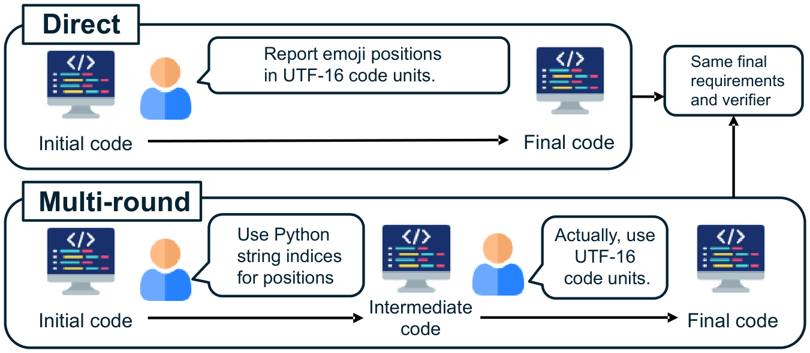
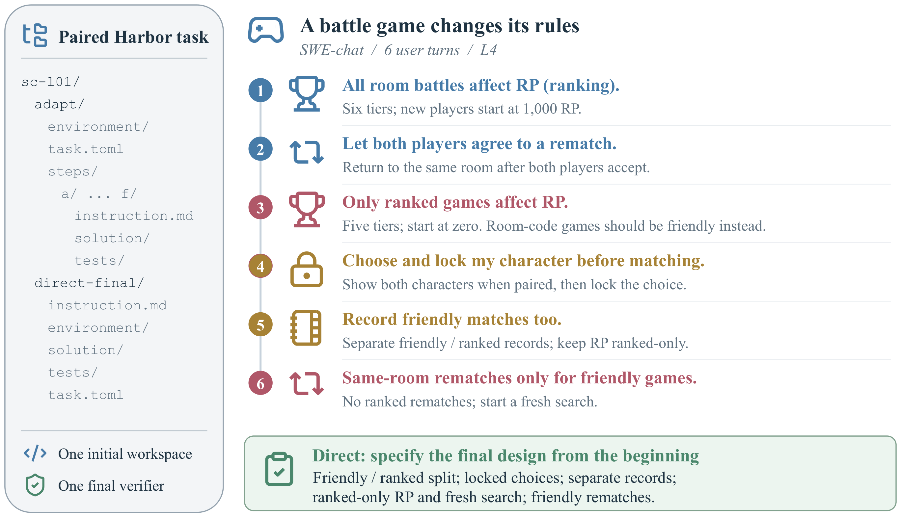
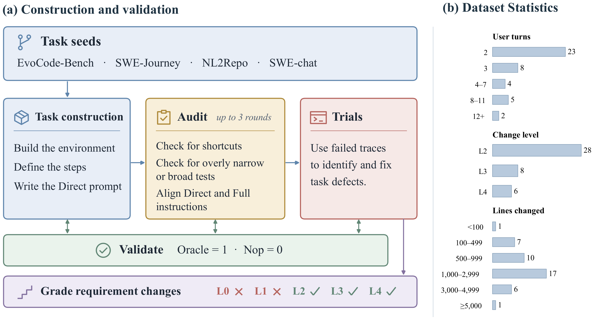

# UReCBench: User Requirement Change Benchmark

How well can coding agents adapt when users change what the software should do?
UReCBench pairs a sequence of changing user requests with a standalone request
for the **same final behavior**, evaluated against the same final verifier.



[Dataset on Hugging Face](https://huggingface.co/datasets/fatty-belly/adaptability-harbor) ·
[Browse task instructions](https://huggingface.co/datasets/fatty-belly/adaptability-harbor/viewer/tasks/test) ·
[Four examples](examples/README.md)

## Benchmark

The frozen release contains **42 repository-level tasks: 23 two-turn and 19
multi-round**, with sequences of up to 23 user requests. Each family has two
native Harbor packages: `adapt` and `direct-b` or `direct-final`.

| Source | Two-turn | Multi-round | Total |
|---|---:|---:|---:|
| EvoCode-Bench | 6 | 7 | 13 |
| NL2Repo-Bench | 9 | 7 | 16 |
| SWE-Journey | 2 | 2 | 4 |
| SWE-chat | 6 | 3 | 9 |
| **Total** | **23** | **19** | **42** |



Tasks are constructed from existing benchmarks, open-source repositories, and
real user sessions, then validated with reference/no-edit controls and reviewed
for instruction–test alignment. Pilot evaluations informed final task selection.
The release retains 28 L2, 8 L3, and 6 L4 tasks; whole-task L0/L1 cases are excluded.



## Task examples

| Example | Source | Turns | Requirement change |
|---|---|---:|---|
| [Nexus run-record migration](examples/README.md#nexus-run-record-migration) | EvoCode-Bench | 2 | Array-based step records become name-indexed records while preserving old runs and artifact lookup. |
| [Emoji-Process offsets](examples/README.md#emoji-process-offsets) | NL2Repo-Bench | 2 | Existing match APIs switch from Python indices to UTF-16 code units. |
| [Dungeon lighting](examples/README.md#dungeon-lighting) | SWE-chat | 3 | Lighting moves from authored emitters to identity-based inference, then restores an emitter design for fixed decorations. |
| [qutebrowser diagnostics](examples/README.md#qutebrowser-diagnostics) | SWE-Journey | 18 | Diagnostic collection evolves into a shareable surface with privacy redaction enabled by default. |

Examples contain the complete instructions from the current release. Environments,
reference solutions, and verifiers are distributed in the Hugging Face dataset.

## Install and download

Use Linux, Python 3.12, Docker, and Docker Compose. The runner pins Harbor 0.23.0
and includes the tested process-local backport of Harbor
[PR #1961](https://github.com/harbor-framework/harbor/pull/1961), which clears shared
verifier files before the next user stage. It checks the native lifecycle before
installation and aborts on an unsupported version; it does not edit site-packages.

```bash
python -m venv .venv
source .venv/bin/activate
python -m pip install -r requirements.txt

# Required while the dataset is private: use an account with access.
hf auth login
python -m evaluation.download_data --local-dir /data/benchmarks/urecbench-42
```

**The dataset is expanded, not one `.tar.gz` archive.** Downloads are incremental.
The command validates file checksums and restores executable permissions that HF
snapshots do not preserve. Published `task.toml` files already include final
workload-aware time budgets and workspace capture declarations; no instruction,
verifier, or artifact-capture patching step is required.
The default dataset revision is the frozen tag `urecbench-42-v1`.
Use `--revision HF_COMMIT_OR_TAG` to select a specific revision. Keep data and solver
outputs outside this code checkout. Individual environment assets may still be
archives consumed by their Dockerfiles; these are build inputs, not the dataset
packaging format.

The HF page provides two browsing configurations:

- **`tasks`**: one row per family, including source, turn count, change level,
  Direct instruction, ordered Full instructions, budgets, and package paths.
- **`requests`**: one row per user request, making long chains easier to browse.

Hugging Face's [private Dataset Viewer](https://huggingface.co/docs/hub/datasets-viewer)
requires a PRO account or a Team/Enterprise organization. Without that plan,
authorized users can still browse the expanded files or read the Parquet indexes
locally; public datasets support the online viewer.

You can also inspect these indexes with `datasets.load_dataset`:

```python
from datasets import load_dataset  # optional: pip install datasets
tasks = load_dataset("fatty-belly/adaptability-harbor", "tasks", split="test", token=True)
```

The Parquet indexes support browsing; the expanded Harbor directories are the
executable benchmark. Private-dataset access restrictions also apply to its viewer.

## Evaluation protocol

Terminus-2 is used in all conditions, with **three samples per family** by default.

| Condition | Families | Default samples | Starting state |
|---|---:|---:|---|
| **Direct** (`direct`, alias `baseline`) | 42 | 126 | Initial workspace, fresh conversation, standalone final request. |
| **Full** (`full`) | 42 | 126 | Initial workspace at A; code, conversation, and terminal session carry across user turns. |
| **Reset** (`reset`) | 23 two-turn | 69 | The paired Full sample's saved A workspace, with a fresh conversation for B. |
| **Oracle** (`oracle`) | 23 two-turn | 69 | A verified reference implementation of A, with a fresh conversation for B. |

Full continues after failed intermediate checks; **only the last verifier determines
final success**. Verifier feedback is not added to the agent conversation. Agent
timeouts are scored using the saved implementation, rather than automatically
counted as failures. API/infrastructure errors are retried within the configured limit.

Reset includes both successful and failed A samples. Its checkpoint must reproduce
the saved A reward; Oracle must pass A. These prechecks make no model calls. Both
conditions prepend the same sentence to the existing B instruction:

> Continue from the existing implementation in the workspace.

Direct budgets are 2–6 hours. Each Full stage has a workload-based budget of at least
20 minutes; Full totals are 1.17–1.80 times the corresponding Direct budget. Reset
and Oracle use the same B budget as Full. There is no separate token/cost/turn cutoff.

## Configure and run

Edit [`evaluation/example.json`](evaluation/example.json) to choose the model,
reasoning effort, samples, concurrency, retries, and Docker settings. Credentials
belong in environment variables, never configuration files or commits.

```bash
export OPENAI_API_KEY="YOUR_API_KEY"
# Optional gateway: set api_base in your local JSON config.

# Offline validation: no model calls or Docker launches.
python -m evaluation.run --data /data/benchmarks/urecbench-42 \
  --run-dir /data/runs/urecbench-model --arms all --dry-run

# Main experiments.
python -m evaluation.run --data /data/benchmarks/urecbench-42 \
  --run-dir /data/runs/urecbench-model --config evaluation/example.json \
  --arms direct,full

# Two-turn ablations using the same run directory and Full checkpoints.
python -m evaluation.run --data /data/benchmarks/urecbench-42 \
  --run-dir /data/runs/urecbench-model --config evaluation/example.json \
  --arms reset,oracle
```

`--arms all` runs both phases in order. `--include FAMILY_ID ...` selects a subset;
`--model MODEL` overrides the configured model using Harbor/LiteLLM naming.
Concurrency is the combined number of active slots, not a per-condition limit.
A run directory freezes configuration and task checksums. Reuse it to resume
completed slots; use a new directory for a different model or configuration.

The Docker adapter adds `tmux` to build images that lack it and accepts optional
`docker_build_network` (`null`, `host`, `default`, or `none`). `DOCKER_HOST` can
select a daemon. Task environments must be buildable on the host; Docker image
pulls and dependency downloads may require network access.

Results are stored under `arms/`; Direct keeps the historical directory key
`baseline` for compatibility. `summary.json` reports completion, passes, and errors
by condition and by two-turn/multi-round track. The corresponding native Harbor
results, checkpoints, and isolation receipts are retained for inspection.

## Development checks

```bash
python -m unittest discover -s tests -v
```

These tests exercise data integrity, path validation, and shared-verifier isolation
without model calls. Benchmark tasks and results are not changed by the tests.
