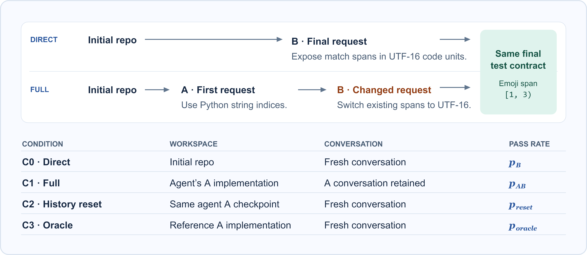
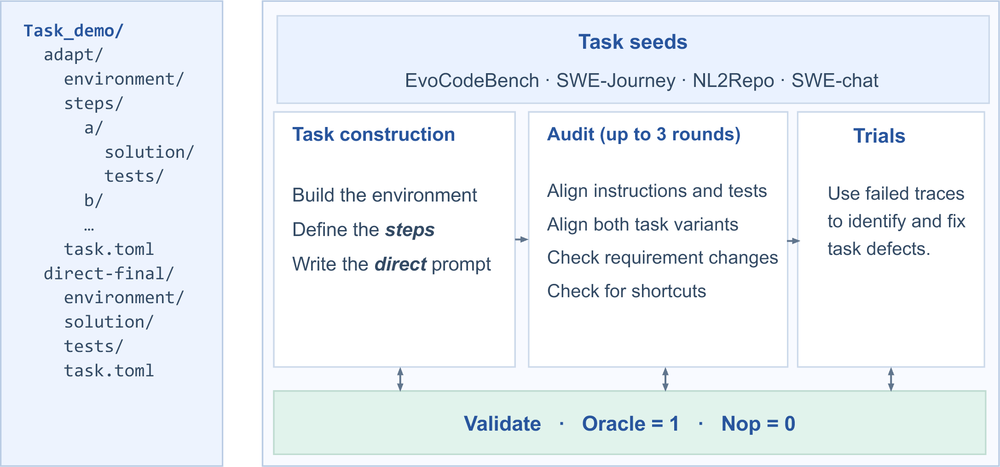

# Adaptability Benchmark





How well do coding agents adapt when users change what the software should do?
Adaptability Benchmark pairs a sequence of changing requests with a standalone
request for the same final behavior. Both paths start from the same repository
and are scored against the same final requirements.

## Task examples

| Example | Source | Turns | Requirement change |
| --- | --- | ---: | --- |
| [Mini compiler closures](examples/README.md#mini-compiler-closures) | EvoCodeBench | 2 | Snapshot capture becomes shared lexical bindings. |
| [Emoji-Process offsets](examples/README.md#emoji-process-offsets) | NL2Repo | 2 | Existing match APIs switch from Python indices to UTF-16 code units. |
| [Dungeon lighting](examples/README.md#dungeon-lighting) | SWE-chat | 3 | Lighting moves from authored emitters to identity-based inference, then returns to an emitter design for fixed decorations. |
| [qutebrowser diagnostics](examples/README.md#qutebrowser-diagnostics) | SWE-Journey | 18 | Debugging output grows into a shareable diagnostic surface with redaction on by default. |

Each example includes all original turn instructions and its standalone final
instruction. Download the full Harbor packages to run them.

## Evaluation

The runner evaluates 79 Harbor task families (43 two-turn and 36 multi-turn)
with Terminus-2. The default is five independent samples per condition and
family. For two-turn tasks, $q$ is the final pass rate among `full` runs that
passed A.

| Condition | Families | Default samples | Model-visible starting state |
|---|---:|---:|---|
| `baseline` | 79 | 395 | Fresh workspace and conversation. The direct-B or direct-final instruction is given as a single task. |
| `full` | 79 | 395 | Fresh workspace at A. Subsequent turns keep the code and conversation, including after a failed verifier result. Only the last turn contributes the final score. |
| `reset` | 43 two-turn | 215 | The corresponding `full` sample's saved A workspace. B starts a fresh conversation. |
| `oracle` | 43 two-turn | 215 | The released A reference implementation. B starts a fresh conversation. |

Every two-turn `full` sample contributes a slot to each ablation, including
samples that failed A. Both ablations use the existing B instruction with the
same opening sentence.

> Continue from the existing implementation in the workspace.

The runner checks the restored workspace against the saved archive, then runs
the original A verifier before B. Reset must reproduce the paired A reward.
Oracle must pass A. An invalid checkpoint is recorded as an error. B uses the
released B verifier and task time limit. Source trials, verifier logs and
per-slot results are stored separately under the output directory.

## Install and download

Run the following from the repository root on a Linux host with Python 3.12 and
an accessible Docker daemon with Docker Compose. Harbor 0.23.0 is the version
used for this runner.

```bash
python -m venv .venv
source .venv/bin/activate
python -m pip install -r requirements.txt

hf auth login
hf download fatty-belly/adaptability-harbor adaptability-harbor.tar.gz \
  --repo-type dataset --local-dir /data/benchmarks/adaptability-download
mkdir -p /data/benchmarks/adaptability-harbor
tar -xzf /data/benchmarks/adaptability-download/adaptability-harbor.tar.gz \
  -C /data/benchmarks/adaptability-harbor
python -m evaluation.prepare_data /data/benchmarks/adaptability-harbor
```

The [Hugging Face dataset](https://huggingface.co/datasets/fatty-belly/adaptability-harbor)
is private. Authenticate with an account that has dataset access. The archive
contains both native Harbor variants for each family. Keep the dataset and run
outputs on a data volume outside this checkout.

## Configure and run

Copy [`evaluation/example.json`](evaluation/example.json) to a local JSON file to set the model,
reasoning effort, attempts per family, concurrency, retry budget and Harbor
environment. The model name follows Harbor and LiteLLM conventions. Configure
provider credentials in your shell, for example `OPENAI_API_KEY` for an OpenAI
compatible provider. Set `api_base` in the config, or the provider's environment
variables, when using a gateway. Keep credentials out of config files.

The default extends Harbor's Docker driver with a build overlay that installs
`tmux` when the task image lacks it. The overlay lives in the run directory.
Images must be able to build on the evaluation host. To use a site-specific
driver, set `environment` to its Harbor import path and supply the required host
environment variables. For example, `DOCKER_HOST` selects the Docker daemon.
The default driver accepts `docker_build_network` when the daemon requires a
specific build network. A null value uses Docker's defaults.
The idempotent preparation command adds the missing `/app` artifact
declarations to eight extracted `task.toml` files. The runner reads those
declarations through Harbor.

```bash
# Validate the extracted data and enumerate all four conditions offline.
python -m evaluation.run --data /data/benchmarks/adaptability-harbor \
  --run-dir /data/runs/adaptability-run-1 --dry-run

# Run baseline and full, then use the full checkpoints for reset and oracle.
python -m evaluation.run --data /data/benchmarks/adaptability-harbor \
  --run-dir /data/runs/adaptability-run-1 --config evaluation/example.json --arms all
```

Use `--arms baseline,full` followed by `--arms reset,oracle` with the same
configuration, dataset and run directory to schedule the phases separately.
Use `--include FAMILY_ID ...` for a small subset, and `--model MODEL` to override
the config's model. The run directory freezes the model configuration and task
checksums. Changing either requires a new run directory.

Completed slot results are reusable when restarting the same run. Each attempt
keeps its invocation receipt and native result. An unfinished invocation needs
inspection before recovery. The runner retries recognized infrastructure errors
within the configured limit and keeps genuine verifier zeros. `summary.json`
reports planned, completed, passed and error counts by condition and task track.
The `arms/` directory contains the per-sample records used to calculate paired
and A-conditioned statistics.
